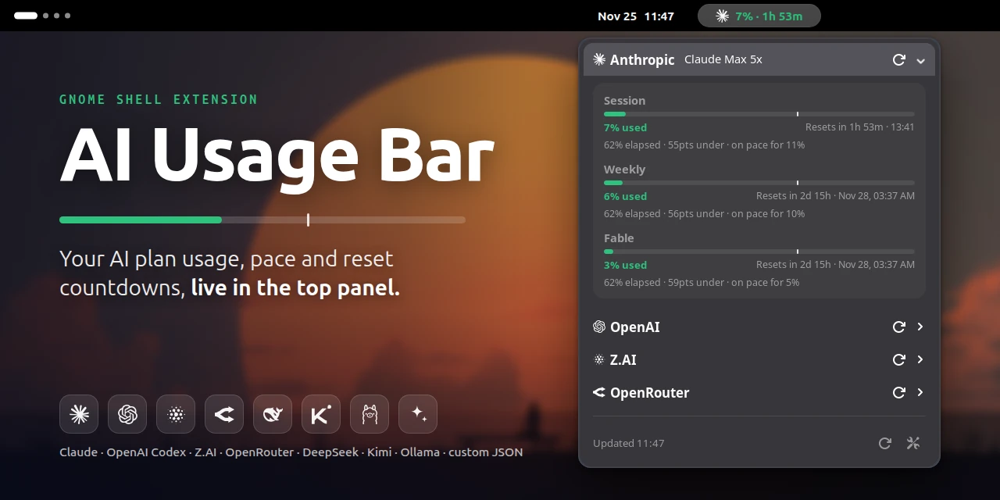
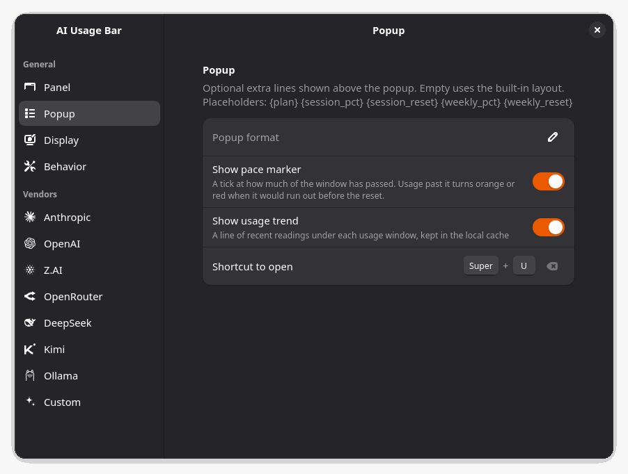

<div align="center">

# AI Usage Bar

**See how much of your AI plan you have left, right in the GNOME top bar.**

[](https://github.com/wilfison/ai-usagebar/releases/latest)
[](#-install)
[](LICENSE)



</div>

## ✨ What it does

- 📊 Shows your usage as a small label in the top bar, like `42% · 3h12m`.
- 🚦 Turns green, orange or red as you get close to the limit.
- 🖱️ Click it for the full picture; scroll over it to switch providers.
- 📌 Pin several providers to watch them side by side.
- 🔔 Notifies you before you hit the limit.
- 🔒 No tracking: your keys only go to the provider they belong to.

## 🤖 Supported providers

| Provider | What you see | What you need |
| --- | --- | --- |
| **Anthropic (Claude)** | Session and weekly usage, model limits, extra usage, credits, plan | Be logged in to [Claude Code](https://claude.com/claude-code) |
| **OpenAI (Codex)** | 5h and weekly usage, code review, credits | Be logged in to [Codex CLI](https://github.com/openai/codex) |
| **Z.AI / GLM** | Plan usage and reset times | API key |
| **OpenRouter** | Credit balance and usage | API key |
| **DeepSeek** | Balance | API key |
| **Kimi** | Weekly quota and 5h window, plan | API key |
| **Ollama Cloud** | Session and weekly usage, or monthly credits | API key ([create one](https://ollama.com/settings/keys)) |
| **Custom** | Anything from your own JSON endpoint | URL and an optional key |

Claude and Codex need no setup: the extension reads the login those tools already saved.

## 📦 Install

You need **GNOME Shell 47 to 51**. Releases are published only here on GitHub.

**1.** Download and install the latest release:

```bash
curl -fsSLO https://github.com/wilfison/ai-usagebar/releases/latest/download/ai-usagebar@wilfison.shell-extension.zip
gnome-extensions install --force ai-usagebar@wilfison.shell-extension.zip
```

**2.** Log out and back in, then turn it on:

```bash
gnome-extensions enable ai-usagebar@wilfison
```

## ⚙️ Setup

Open the settings with the ⚙️ button at the bottom of the popup (or run
`gnome-extensions prefs ai-usagebar@wilfison`).

1. Go to **Vendors** and switch on the providers you use.
2. Paste the API key where one is needed. You can also set it as an environment
   variable (`ZAI_API_KEY`, `OPENROUTER_API_KEY`, `DEEPSEEK_API_KEY`,
   `KIMI_API_KEY`, `OLLAMA_API_KEY`).
3. Under **General**, pick where the label goes, what it shows and how often it
   refreshes.



## 💡 Good to know

| | |
| --- | --- |
| ⌨️ **Shortcut** | `Super+U` opens the popup. |
| ⏸ **Offline** | If a refresh fails, the last numbers stay on screen with a `⏸` mark for up to 7 days. |
| ⏳ **Refresh** | Every 5 minutes at most (providers block faster checks). If a provider asks to slow down, it waits 5 minutes. |
| 🔔 **Alerts** | One notification per window at 97% (you can change it). Another only after usage drops or resets. |
| ▲ **Outages** | When Claude or Codex has an incident, its name turns yellow, orange or red in the popup. |
| 🆕 **Updates** | A link appears in the popup when a new version is out. |

## 🔒 Privacy

- Keys and logins are read on your computer and sent **only** to their own provider, over HTTPS.
- **No telemetry, no analytics.** The only other requests are a daily update check
  to GitHub and the Claude / OpenAI status pages. Both can be turned off.
- Only the numbers shown in the popup are cached, in `~/.cache/ai-usagebar/`.
  Keys are never copied or logged.

## 🧩 Advanced

| Guide | What it covers |
| --- | --- |
| 🏷️ [Customize the label](docs/features/label-placeholders.md) | Every `{token}` you can put in the panel label and popup rows |
| 🔌 [Add your own provider](docs/features/custom-provider-setup.md) | Turn any JSON endpoint into a provider, with a full example |

<details>
<summary><b>Several providers on the panel</b></summary>

Under *Panel* → *Vendors on the panel*, switch on the ones to pin. Each gets its
own logo and label; clicking one opens the popup on it. While any is pinned,
scrolling does nothing. A segment shows `…` while loading and `⚠` on an error.
Only providers on the panel are refreshed on a timer; the others refresh when
you open them or press "Refresh all". In the center of the panel, a short format
such as `{session_pct}%` keeps the clock in place.

</details>

<details>
<summary><b>Claude Code context monitor</b></summary>

On the Anthropic page, **Show session context** lists your latest Claude Code
sessions and how full each context window is. It reads `~/.claude/projects` only
while the option is on. Set a window size to see a percentage instead of a token
count.

</details>

<details>
<summary><b>Credential paths and variables</b></summary>

- Claude: `~/.claude/.credentials.json` (refreshed automatically).
- Codex: `~/.codex/auth.json`.
- OpenRouter also takes an optional management key
  (`OPENROUTER_MANAGEMENT_API_KEY`) to list your two latest models.
- An environment variable wins over the key typed in settings. Variable names and
  both paths can be changed in settings.

</details>

## 🛠️ For developers

There is no build step: GNOME Shell loads the JS as is. To see the extension in
action, start a nested GNOME Shell in a window:

```bash
make run
```

Other `Makefile` targets (`make` lists them all):

```bash
make test      # unit tests (gjs)
make lint      # hygiene lint
make eslint    # needs `npm ci`
make validate  # metadata.json + schema
make logs      # follow the gnome-shell journal
make pack      # build the installable zip
```

<details>
<summary>Dependencies</summary>

```bash
# Ubuntu
sudo apt install gjs libglib2.0-bin gettext gir1.2-soup-3.0 mutter-dev-bin
# Arch
sudo pacman -S gjs glib2-devel gnome-shell gettext libsoup3 mutter
```

</details>

How it works inside is in [`docs/`](docs/index.md); the short version is
[`CLAUDE.md`](CLAUDE.md). Issues and pull requests are welcome. Found a bug?
[Open an issue](https://github.com/wilfison/ai-usagebar/issues).

## 📄 Credits and license

Inspired by the [`akitaonrails/ai-usagebar`](https://github.com/akitaonrails/ai-usagebar)
Waybar widget. [MIT license](LICENSE).

Provider names and logos in [`icons/`](icons/) ([sources](icons/README.md)) only
identify each service; they belong to their owners, with no affiliation implied.
Turn **Show vendor logos** off to show short codes instead.
